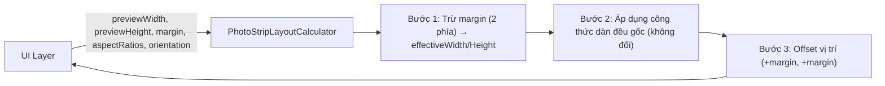
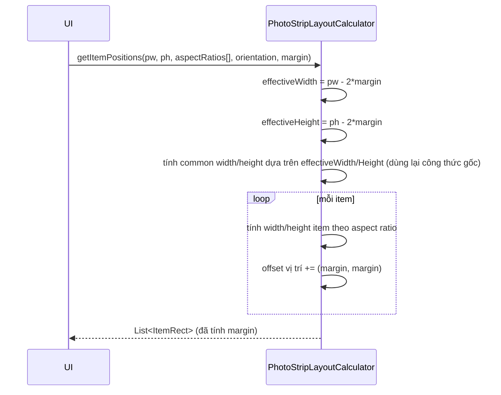

# Tài liệu bổ sung — Tính năng Margin cho PhotoStripLayoutCalculator

> Tài liệu này là **bổ sung (addendum)** cho `PhotoStripLayoutCalculator_Docs.md`.
> Không thay đổi các API/công thức đã mô tả trước đó — chỉ mô tả phần **mở rộng thêm margin**.
>
> **Margin là một giá trị số đơn (single float), áp dụng đều cho cả 4 cạnh** (trái, phải, trên, dưới) của preview.

---

## 1. SRS — Software Requirements Specification (Margin)

### 1.1. Mục đích
Bổ sung khả năng chừa khoảng cách (margin) đều nhau ở 4 cạnh của vùng preview trước khi dàn đều các item, để item không bị dính sát viền preview.

### 1.2. Phạm vi
- Áp dụng cho cả 2 orientation (Vertical, Horizontal) và cả 2 trạng thái (zoom-out, zoom-in).
- Margin chỉ ảnh hưởng đến **vùng tính toán** (effective area) và **vị trí offset** của item; không thay đổi tỉ lệ khung hình của từng item.

### 1.3. Định nghĩa & thuật ngữ
| Thuật ngữ | Ý nghĩa |
|---|---|
| Margin | Một giá trị `float` duy nhất, biểu thị khoảng cách chừa ra ở **cả 4 cạnh** (trái = phải = trên = dưới = margin) của preview |
| Effective area | Vùng còn lại sau khi trừ margin ở cả 2 phía mỗi chiều: `effectiveWidth = previewWidth - 2*margin`, `effectiveHeight = previewHeight - 2*margin` |
| Content area | Đồng nghĩa với effective area — vùng thực sự dùng để dàn item |

### 1.4. Yêu cầu chức năng

**FR-M1**: Người dùng API truyền vào **một giá trị margin duy nhất** (`float margin`), áp dụng đồng thời cho cả 4 cạnh của preview.

**FR-M2**: Việc dàn đều item (width bằng nhau với Vertical / height bằng nhau với Horizontal) phải được tính dựa trên **effective area** (`previewWidth - 2*margin`, `previewHeight - 2*margin`), không phải trên `previewWidth`/`previewHeight` gốc.

**FR-M3**: Vị trí (`ItemRect`) của item trả về từ `getItemPositions` phải được **dịch (offset)** vào trong đúng `margin` theo cả trục X và trục Y, sao cho item đầu tiên bắt đầu ngay tại mép trong của margin, không đè lên vùng margin.

**FR-M4**: Các hàm tính kích thước ở trạng thái zoom-out/zoom-in (`getVeritcalWidthOnZoomOutState`, `getHorizontalHeightOnZoomOutState`, `getVeritcalHeightOnZoomInState`, `getHorizontalWidthOnZoomInState`) phải có phiên bản overload nhận thêm tham số `margin`, tính toán dựa trên effective width/height thay vì preview width/height.

**FR-M5**: Khi `margin = 0`, kết quả phải **giống hệt** kết quả của các hàm gốc (không margin) — đảm bảo tính tương thích ngược (backward compatible).

**FR-M6**: Nếu `2*margin >= previewWidth` hoặc `2*margin >= previewHeight`, effective area theo chiều đó ≤ 0 → hệ thống phải xử lý an toàn (không NaN/Infinity/crash), trả về kích thước 0 hoặc danh sách rỗng tùy hàm.

### 1.5. Yêu cầu phi chức năng

**NFR-M1**: Không phá vỡ API cũ — bổ sung bằng overload method, không sửa signature các hàm hiện có.

**NFR-M2**: Độ phức tạp vẫn O(n), không phát sinh thêm vòng lặp so với bản gốc (chỉ thêm phép trừ/cộng hằng số).

**NFR-M3**: Margin âm được coi là input không hợp lệ ở tầng gọi; class chỉ cần đảm bảo không crash (xem mục 3.4).

### 1.6. Ràng buộc
- `margin >= 0` trong điều kiện sử dụng bình thường.
- Đơn vị margin giống đơn vị `previewWidth/previewHeight` (px hoặc dp tùy tầng gọi).

---

## 2. HLD — High Level Design (Margin)

### 2.1. Cách margin tích hợp vào luồng tính toán hiện có



**Nguyên tắc thiết kế chính**: Margin được xử lý như một **bước tiền xử lý (pre-processing)** — thu nhỏ vùng tính toán đều ở cả 2 phía mỗi chiều trước khi đưa vào đúng công thức đã có ở tài liệu gốc, sau đó **hậu xử lý (post-processing)** để dịch chuyển vị trí thêm `margin`. Điều này giúp:
- Không cần viết lại công thức dàn đều.
- Dễ đảm bảo FR-M5 (tương thích ngược khi margin = 0).

### 2.2. Sequence diagram



### 2.3. Tác động đến các trạng thái layout

| State | Vertical | Horizontal |
|---|---|---|
| Zoom-out (có margin) | width item tính để tổng height = `previewHeight - 2*margin` | height item tính để tổng width = `previewWidth - 2*margin` |
| Zoom-in (có margin) | width item = `previewWidth - 2*margin`, tổng height có thể > effectiveHeight | height item = `previewHeight - 2*margin`, tổng width có thể > effectiveWidth |

---

## 3. LLD — Low Level Design (Margin)

### 3.1. Tham số mới

Không cần class riêng — chỉ là một tham số `float margin` được thêm vào các overload method (đơn giản hơn thiết kế 4 cạnh riêng lẻ):

| Method mới (overload) | Khác biệt so với bản gốc |
|---|---|
| `getItemPositions(pw, ph, ar[], orientation, float margin)` | Trừ margin trước khi tính, offset vị trí sau khi tính |
| `getVeritcalWidthOnZoomOutState(pw, ph, ar[], float margin)` | Dùng `eh = ph - 2*margin` thay vì `previewHeight` |
| `getHorizontalHeightOnZoomOutState(pw, ph, ar[], float margin)` | Dùng `ew = pw - 2*margin` thay vì `previewWidth` |
| `getVeritcalHeightOnZoomInState(pw, ph, ar[], float margin)` | Dùng `ew = pw - 2*margin` thay vì `previewWidth` |
| `getHorizontalWidthOnZoomInState(pw, ph, ar[], float margin)` | Dùng `eh = ph - 2*margin` thay vì `previewHeight` |

### 3.2. Công thức cập nhật

Ký hiệu: `ew = previewWidth - 2*margin` (effective width), `eh = previewHeight - 2*margin` (effective height).

| Hàm | Công thức |
|---|---|
| `getVeritcalWidthOnZoomOutState` (có margin) | `W = eh / Σ(1/ar[i])` |
| `getHorizontalHeightOnZoomOutState` (có margin) | `H = ew / Σ(ar[i])` |
| `getVeritcalHeightOnZoomInState` (có margin) | `totalHeight = ew * Σ(1/ar[i])` |
| `getHorizontalWidthOnZoomInState` (có margin) | `totalWidth = eh * Σ(ar[i])` |

### 3.3. Thuật toán `getItemPositions` (có margin)

```
input: previewWidth, previewHeight, ar[1..n], orientation, margin
output: list ItemRect[1..n]

ew = previewWidth - 2*margin
eh = previewHeight - 2*margin

if ar rỗng/null OR ew <= 0 OR eh <= 0:
    return []

if orientation == VERTICAL:
    W = eh / sumInverse(ar)          // dùng eh thay vì previewHeight
    top = margin                     // offset ban đầu theo margin
    for i in 1..n:
        h_i = W / ar[i]
        rect_i = (left = margin,
                  top = top,
                  right = margin + W,
                  bottom = top + h_i)
        top += h_i

else (HORIZONTAL):
    H = ew / sum(ar)                 // dùng ew thay vì previewWidth
    left = margin                    // offset ban đầu theo margin
    for i in 1..n:
        w_i = H * ar[i]
        rect_i = (left = left,
                  top = margin,
                  right = left + w_i,
                  bottom = margin + H)
        left += w_i

return list of rect_i
```

### 3.4. Xử lý biên (defensive design)
- `ew <= 0` hoặc `eh <= 0` (margin quá lớn so với preview, tức `2*margin >= previewWidth` hoặc `2*margin >= previewHeight`) → trả về danh sách rỗng cho `getItemPositions`, trả về `0` cho các hàm tính kích thước.
- Margin âm: không tự động clamp về 0 ở tầng tính toán (coi là lỗi input của tầng gọi), nhưng vẫn phải đảm bảo không crash — công thức vẫn hoạt động về mặt toán học (margin âm tương đương "mở rộng" preview), tầng gọi chịu trách nhiệm validate nếu không muốn hành vi này.
- Khi `margin = 0`: `ew = previewWidth`, `eh = previewHeight` → kết quả **giống hệt** hàm gốc (đáp ứng FR-M5).

### 3.5. Tương thích với API cũ
- Các hàm gốc (không có tham số `margin`) giữ nguyên hành vi, có thể được coi là **gọi hàm mới với `margin = 0`** — nên khuyến nghị implement hàm gốc bằng cách delegate sang hàm mới, tránh trùng lặp logic:

```java
public List<ItemRect> getItemPositions(float previewWidth, float previewHeight,
                                        float[] imageAspectRatio, Orientation orientation) {
    return getItemPositions(previewWidth, previewHeight, imageAspectRatio, orientation, 0f);
}
```

---

## 4. TDD — Test Design Document (Margin)

### 4.1. Chiến lược test
- Bổ sung test case mới, không sửa test case cũ (đảm bảo bản gốc không bị regression).
- Test tập trung vào 3 nhóm: **Tương thích ngược** (margin=0), **Margin hợp lệ** (dàn đều đúng trong effective area), **Margin biên/suy biến** (margin quá lớn).

### 4.2. Test case — Tương thích ngược (FR-M5)

| ID | Input | Kỳ vọng |
|---|---|---|
| TC-M-BC-01 | margin=0, so sánh với hàm gốc cùng input | Kết quả `getItemPositions` giống hệt (từng rect bằng nhau, sai số < DELTA) |
| TC-M-BC-02 | margin=0 cho `getVeritcalWidthOnZoomOutState` | Bằng kết quả hàm gốc không margin |

### 4.3. Test case — Margin hợp lệ, Vertical

| ID | Input | Kỳ vọng |
|---|---|---|
| TC-M-V-01 | pw=1080, ph=1920, margin=20, ar=[1.0,1.0] | ew=1040, eh=1880 → W = 940 (=1880/2); rect đầu: left=20, top=20, right=960, bottom=960 |
| TC-M-V-02 | Cùng input trên | Tổng height 2 item = eh = 1880 (không tính margin vào tổng) |
| TC-M-V-03 | Cùng input trên | Item cuối có `bottom = margin + eh = 1900` |
| TC-M-V-04 | Kiểm tra width mọi item bằng nhau = W, và `W = ew` (vì Vertical: width item = effective width toàn bộ) | true |

### 4.4. Test case — Margin hợp lệ, Horizontal

| ID | Input | Kỳ vọng |
|---|---|---|
| TC-M-H-01 | pw=1920, ph=1080, margin=20, ar=[1.0,1.0] | ew=1880, eh=1040 → H tính theo Σ(ar); rect đầu bắt đầu tại left=20, top=20 |
| TC-M-H-02 | Cùng input trên | Tổng width 2 item = ew (không tính margin vào tổng) |
| TC-M-H-03 | Kiểm tra height mọi item bằng nhau = H và `H = eh` | true |

### 4.5. Test case — Margin biên / suy biến (FR-M6)

| ID | Input | Kỳ vọng |
|---|---|---|
| TC-M-EDGE-01 | pw=1080, margin=600 (2*600 > 1080) | `ew <= 0` → `getItemPositions` trả về list rỗng |
| TC-M-EDGE-02 | ph=1920, margin=1000 (2*1000 > 1920) | `eh <= 0` → `getItemPositions` trả về list rỗng |
| TC-M-EDGE-03 | margin = pw/2 (đúng bằng, ew=0) | `getVeritcalWidthOnZoomOutState` trả 0, không NaN/Infinity |
| TC-M-EDGE-04 | ar rỗng, margin hợp lệ | trả về list rỗng (giống hành vi gốc, margin không ảnh hưởng) |
| TC-M-EDGE-05 | margin âm nhỏ, ví dụ margin = -10 | Không throw exception; `ew`, `eh` tăng lên tương ứng (ghi nhận hành vi, không coi là lỗi ở tầng calculator) |

### 4.6. Test case — Không méo tỉ lệ ảnh khi có margin

| ID | Input | Kỳ vọng |
|---|---|---|
| TC-M-AR-01 | ar=[1.0, 2.0, 0.5], margin=15, VERTICAL | mỗi rect: `rect.width()/rect.height()` ≈ `ar[i]` (sai số < DELTA), không phụ thuộc margin |
| TC-M-AR-02 | Tương tự với HORIZONTAL | Tương tự |

### 4.7. Ma trận truy vết yêu cầu (Margin)

| Requirement | Test case liên quan |
|---|---|
| FR-M1 | TC-M-V-01, TC-M-H-01 |
| FR-M2 | TC-M-V-01/02, TC-M-H-01/02 |
| FR-M3 | TC-M-V-01/03, TC-M-H-01 |
| FR-M4 | TC-M-BC-02, toàn bộ nhóm TC-M-V-*, TC-M-H-* |
| FR-M5 | TC-M-BC-01, TC-M-BC-02 |
| FR-M6 | TC-M-EDGE-01 → 04 |
| NFR-M3 | TC-M-EDGE-05 |

### 4.8. Ví dụ code test (JUnit)

```java
public class PhotoStripLayoutCalculatorMarginTest {

    private final PhotoStripLayoutCalculator calculator = new PhotoStripLayoutCalculator();
    private static final float DELTA = 0.001f;

    @Test
    public void margin_zero_isBackwardCompatible() {
        float[] ar = {1.0f, 1.0f};

        List<ItemRect> withMargin = calculator.getItemPositions(
                1080, 1920, ar, Orientation.VERTICAL, 0f);
        List<ItemRect> original = calculator.getItemPositions(
                1080, 1920, ar, Orientation.VERTICAL);

        assertEquals(original.size(), withMargin.size());
        for (int i = 0; i < original.size(); i++) {
            assertEquals(original.get(i).left, withMargin.get(i).left, DELTA);
            assertEquals(original.get(i).top, withMargin.get(i).top, DELTA);
            assertEquals(original.get(i).right, withMargin.get(i).right, DELTA);
            assertEquals(original.get(i).bottom, withMargin.get(i).bottom, DELTA);
        }
    }

    @Test
    public void margin_vertical_offsetsAndShrinksEffectiveArea() {
        float[] ar = {1.0f, 1.0f};
        float margin = 20f;

        List<ItemRect> positions = calculator.getItemPositions(
                1080, 1920, ar, Orientation.VERTICAL, margin);

        // width mọi item = effectiveWidth = 1080 - 2*20 = 1040
        assertEquals(1040f, positions.get(0).width(), DELTA);

        // item đầu bắt đầu tại đúng margin
        assertEquals(20f, positions.get(0).left, DELTA);
        assertEquals(20f, positions.get(0).top, DELTA);

        // tổng height = effectiveHeight = 1920 - 2*20 = 1880
        float totalHeight = 0f;
        for (ItemRect rect : positions) totalHeight += rect.height();
        assertEquals(1880f, totalHeight, DELTA);
    }

    @Test
    public void margin_tooLarge_returnsEmptyList() {
        float[] ar = {1.0f};
        float margin = 600f; // 2*600 = 1200 > previewWidth=1080

        List<ItemRect> positions = calculator.getItemPositions(
                1080, 1920, ar, Orientation.VERTICAL, margin);

        assertTrue(positions.isEmpty());
    }
}
```
