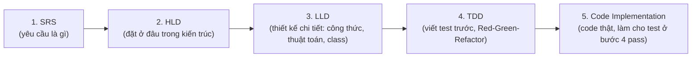

# Quy trình chuẩn khi thêm feature mới — Case study: Margin

> Nguyên tắc: **không được nhảy cóc**. Mỗi bước sau chỉ bắt đầu khi bước trước đã chốt xong.
> Tài liệu này liệt kê chính xác các bước đã làm cho feature Margin, kèm link tới artifact
> (file) sinh ra ở mỗi bước, để dùng làm mẫu (template quy trình) cho feature tiếp theo.

**Vì sao phải đúng thứ tự này:**
- **SRS** trả lời "hệ thống phải làm được gì" — chưa có SRS thì không biết test cái gì, code cái gì.
- **HLD** trả lời "phần này nằm ở đâu, tương tác với ai" — tránh việc code xong mới phát hiện sai vị trí kiến trúc.
- **LLD** trả lời "làm chi tiết như thế nào" (công thức, pseudo-code, chữ ký hàm) — đây là bản thiết kế mà TDD và Code phải bám theo, tránh mỗi người hiểu 1 kiểu.
- **TDD** viết test **trước** dựa trên LLD, chạy Red trước khi có code — đảm bảo test thật sự kiểm chứng đúng cái LLD mô tả, không phải test được viết ra để khớp với code có sẵn (dễ bị thiên vị).
- **Code Implementation** là bước cuối, mục tiêu duy nhất là làm cho toàn bộ test ở bước 4 chuyển Green, không thêm logic ngoài phạm vi LLD.

---

## Các bước đã áp dụng cho feature Margin

### Bước 1 — SRS
**Nội dung:** Định nghĩa margin là 1 giá trị áp dụng cho cả 4 cạnh, yêu cầu FR-M1 → FR-M6 (dàn đều trong effective area, offset vị trí, tương thích ngược khi margin=0, xử lý margin quá lớn...).
**Artifact:** `PhotoStripLayoutCalculator_Margin_Docs.md` — mục 1.

### Bước 2 — HLD
**Nội dung:** Margin được xử lý như bước tiền xử lý (trừ margin → effective area) trước khi tái sử dụng đúng công thức layout gốc, sau đó hậu xử lý offset vị trí. Có sequence diagram mô tả luồng.
**Artifact:** `PhotoStripLayoutCalculator_Margin_Docs.md` — mục 2.

### Bước 3 — LLD
**Nội dung:** Công thức cụ thể (`ew = pw - 2*margin`, `eh = ph - 2*margin`), pseudo-code thuật toán `getItemPositions` có margin, chữ ký các hàm overload, quy tắc xử lý biên (margin quá lớn → trả rỗng/0), và nguyên tắc implement hàm cũ bằng cách delegate sang hàm mới với `margin=0`.
**Artifact:** `PhotoStripLayoutCalculator_Margin_Docs.md` — mục 3.

### Bước 4 — TDD
**Nội dung:** Viết test theo từng requirement (map trong bảng traceability), chứng minh bằng so sánh **IS (trước khi có margin)** vs **AS (sau khi có margin)** trên cùng 1 input cụ thể, đi qua đủ chu trình Red → Green → Refactor trước khi có code thật.
**Artifact:** `PhotoStripLayoutCalculator_Margin_Docs.md` — mục 4, và `TDD_Process_Template_IS_AS.md` — mục 3 (case study IS-AS chi tiết).

### Bước 5 — Code Implementation
**Nội dung:** Code thật trong `PhotoStripLayoutCalculator.java`, bám đúng LLD ở bước 3:
- Thêm overload `getItemPositions(..., float margin)`, `getVeritcalWidthOnZoomOutState(..., float margin)`, `getHorizontalHeightOnZoomOutState(..., float margin)`, `getVeritcalHeightOnZoomInState(..., float margin)`, `getHorizontalWidthOnZoomInState(..., float margin)`.
- 5 hàm cũ (không margin) được sửa thành **delegate** sang hàm mới với `margin = 0f`, đảm bảo đúng FR-M5 (tương thích ngược) mà không viết trùng logic.
- Mỗi hàm overload đều tính `effectiveWidth`/`effectiveHeight` rồi mới áp dụng đúng công thức đã có (không đổi công thức gốc, chỉ đổi input đầu vào của công thức).
**Artifact:** `PhotoStripLayoutCalculator.java` (đã cập nhật).

---

## Bảng tổng hợp (dùng làm checklist cho feature tiếp theo)

| Bước | Câu hỏi cần trả lời | Output bắt buộc phải có trước khi qua bước sau |
|---|---|---|
| 1. SRS | Feature yêu cầu hệ thống làm gì? | Danh sách FR/NFR có ID rõ ràng |
| 2. HLD | Feature nằm ở đâu, luồng dữ liệu ra sao? | Diagram kiến trúc/luồng xử lý |
| 3. LLD | Công thức, thuật toán, chữ ký hàm cụ thể là gì? | Pseudo-code + công thức toán + bảng API contract |
| 4. TDD | Test nào chứng minh từng FR/NFR? Trạng thái Red/Green/Refactor? | Test case (Given-When-Then) + bảng so sánh IS/AS bằng số liệu thật |
| 5. Code | Code có làm toàn bộ test ở bước 4 pass không, có đúng LLD không? | Code thật, chạy full test suite pass 100%, không lệch khỏi LLD |

**Lưu ý quan trọng:** nếu ở bước 5 phát hiện code không khớp được với LLD (ví dụ công thức sai, thiếu case), phải **quay lại bước 3 (LLD) để sửa thiết kế trước**, không tự ý vá trực tiếp trong code rồi bỏ qua LLD — nếu không tài liệu và code sẽ lệch nhau, mất tác dụng làm nguồn tham chiếu cho các feature sau.
