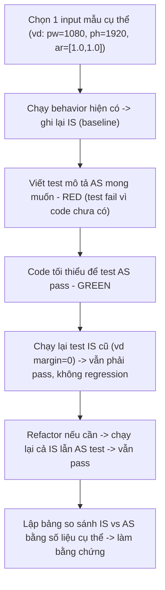

# Template — Chứng minh áp dụng TDD bằng so sánh IS (trước) - AS (sau)

> Mục tiêu: đây là **quy trình chung**, dùng để chứng minh việc áp dụng TDD cho bất kỳ feature nào,
> bằng cách so sánh **kết quả cụ thể trước khi có feature (IS)** và **kết quả sau khi feature được
> implement + pass test (AS)** trên cùng 1 bộ input. Phần cuối có case study thực tế với feature Margin
> và 1 template trống để dùng cho feature tiếp theo.

---

## 1. Định nghĩa IS - AS (theo nghĩa trước/sau)

| Khái niệm | Ý nghĩa |
|---|---|
| **IS** | Kết quả tính toán **TRƯỚC khi feature mới tồn tại** — chạy với cùng bộ input, dùng behavior/method hiện có (baseline). Đây là "hiện trạng". |
| **AS** | Kết quả tính toán **SAU khi feature mới được code xong và test pass** — chạy với cùng bộ input, qua method/overload mới. Đây là "kết quả mong muốn", được chứng minh bằng test pass. |

So sánh IS vs AS trên **cùng 1 input** giúp thấy rõ: feature mới thay đổi cái gì, thay đổi bao nhiêu, và có đúng như spec không — đây chính là bằng chứng trực quan cho việc TDD đã áp dụng đúng.

---

## 2. Quy trình chung (cách làm)



**Diễn giải từng bước:**

1. **Chọn input mẫu cụ thể** — không nói chung chung, phải có con số thật (preview size, aspect ratio...).
2. **Ghi lại IS** — chạy method/behavior hiện tại (trước khi có feature) với input đó, ghi lại kết quả thật (tọa độ, kích thước).
3. **Viết test AS (RED)** — viết test khẳng định kết quả mong muốn *sau khi* có feature, chạy → phải fail vì code chưa hỗ trợ.
4. **Code tối thiểu (GREEN)** — implement feature, chạy lại test AS → pass.
5. **Kiểm tra không phá IS** — chạy lại test ứng với hành vi cũ (thường là case feature "tắt", ví dụ margin=0) → phải vẫn pass, đảm bảo tương thích ngược.
6. **Refactor** — dọn code, chạy lại toàn bộ (cả IS test lẫn AS test) → vẫn pass.
7. **Lập bảng so sánh IS vs AS** — đây là phần dùng để "chứng minh" cho người khác thấy feature hoạt động đúng và có test bảo vệ.

---

## 3. Case study — So sánh IS vs AS cho feature Margin

### 3.1. Input mẫu dùng để so sánh

```
previewWidth  = 1080
previewHeight = 1920
imageAspectRatio = [1.0, 1.0]   // 2 item, ảnh vuông
orientation = VERTICAL
margin (AS) = 20
```

### 3.2. Bảng so sánh kết quả IS (trước, không margin) vs AS (sau, có margin = 20)

| Đại lượng | IS — trước khi có margin | AS — sau khi có margin = 20 | Chênh lệch |
|---|---|---|---|
| Width mỗi item (W) | 960 | 940 | -20 (bị "ăn" 2 lần margin trái/phải) |
| rect[0] (left, top, right, bottom) | (0, 0, 960, 960) | (20, 20, 960, 960) | dịch vào trong đúng 20px cả 2 trục |
| rect[1] (left, top, right, bottom) | (0, 960, 960, 1920) | (20, 960, 960, 1900) | top dịch xuống nhưng bottom co lại còn 1900 |
| Tổng height 2 item | 1920 (= previewHeight) | 1880 (= previewHeight − 2×20) | -40 |
| Vị trí mép ngoài cùng item cuối (bottom) | 1920 (chạm đúng đáy preview) | 1900 (chừa đúng 20px margin dưới) | -20 |

> Trực quan: ở IS, item dàn kín từ 0 đến 1920 (chạm sát viền preview). Ở AS, item được "thụt vào" đúng 20px mỗi phía, tổng chiều cao dùng để dàn item giảm từ 1920 xuống 1880, và width mỗi item cũng giảm tương ứng để vẫn giữ đúng aspect ratio.

### 3.3. Test nào chứng minh cho bảng so sánh trên (map sang TDD cycle)

| Cột trong bảng 3.2 | Test tương ứng | Trạng thái |
|---|---|---|
| Cột IS (960, (0,0,960,960)...) | `getItemPositions_vertical_noOverlapAndFillsHeight` (test gốc, không margin) — vẫn phải pass sau khi thêm feature margin | ☑ Green (không bị regression) |
| Cột AS (940, (20,20,960,960)...) | `margin_vertical_offsetsAndShrinksEffectiveArea` | ☑ Red → ☑ Green → ☑ Refactor |
| Dòng "margin=0 phải giống IS" | `margin_zero_isBackwardCompatible` | ☑ Red → ☑ Green → ☑ Refactor |

### 3.4. Minh họa 1 chu trình Red-Green-Refactor cho đúng dòng "Width mỗi item"

**RED** — viết test khẳng định AS (width phải co lại còn 940), chạy trước khi code hỗ trợ margin tồn tại:
```java
@Test
public void margin_vertical_shrinksItemWidth() {
    float[] ar = {1.0f, 1.0f};
    List<ItemRect> positions = calculator.getItemPositions(
            1080, 1920, ar, Orientation.VERTICAL, /*margin=*/20f);

    // AS: width phải là 940, KHÔNG còn là 960 như IS (baseline không margin)
    assertEquals(940f, positions.get(0).width(), 0.001f);
}
```
→ Chạy: **FAIL** (method `getItemPositions(..., margin)` chưa tồn tại → lỗi compile/NoSuchMethod, hoặc nếu đã có overload nhưng logic chưa trừ margin thì kết quả trả về vẫn là 960 → assertion fail).

**GREEN** — thêm logic effective width/height:
```java
float ew = previewWidth - 2 * margin;   // 1080 - 40 = 1040
float eh = previewHeight - 2 * margin;  // 1920 - 40 = 1880
float W = eh / sumInverse(ar);          // 1880 / 2 = 940
```
→ Chạy lại: **PASS** (940 khớp AS).

**Kiểm tra không phá IS** — chạy lại test gốc `getVeritcalWidthOnZoomOutState` (không truyền margin, hoặc margin=0):
```java
@Test
public void verticalWidthOnZoomOutState_twoEqualItems_noMarginStillWorks() {
    float width = calculator.getVeritcalWidthOnZoomOutState(1080, 1920, new float[]{1.0f, 1.0f});
    assertEquals(960f, width, 0.001f); // IS vẫn đúng 960, không bị ảnh hưởng
}
```
→ **PASS** — chứng minh thêm feature margin không làm sai lệch hành vi cũ.

**REFACTOR** — gom `ew`, `eh` thành hàm dùng chung `computeEffectiveSize(...)`, chạy lại **toàn bộ** test (cả IS test lẫn AS test) → tất cả **PASS**.

---

## 4. Template trống — So sánh IS vs AS cho feature tiếp theo

### 4.1. Input mẫu
```
<liệt kê input cụ thể, có con số thật, không để chung chung>
```

### 4.2. Bảng so sánh

| Đại lượng | IS — trước khi có feature | AS — sau khi có feature | Chênh lệch |
|---|---|---|---|
| `<đại lượng 1>` | | | |
| `<đại lượng 2>` | | | |
| `<đại lượng 3>` | | | |

### 4.3. Map sang test

| Cột trong bảng so sánh | Test tương ứng | Trạng thái |
|---|---|---|
| Cột IS | `<tên test baseline, phải vẫn pass>` | ☐ Green |
| Cột AS | `<tên test mới cho feature>` | ☐ Red ☐ Green ☐ Refactor |

### 4.4. Checklist khi làm case study cho feature mới
- [ ] Chọn 1 (hoặc vài) input mẫu **cụ thể bằng số**, không mô tả chung chung.
- [ ] Chạy behavior hiện tại, ghi lại đúng số liệu làm cột IS.
- [ ] Viết test AS trước (RED), xác nhận fail.
- [ ] Code tối thiểu, chạy lại AS test (GREEN).
- [ ] Chạy lại test ứng với IS (baseline / feature tắt) — phải vẫn pass, không regression.
- [ ] Refactor, chạy lại toàn bộ.
- [ ] Điền bảng so sánh IS vs AS bằng số liệu thật + map sang tên test cụ thể — đây là phần dùng để chứng minh/báo cáo.
